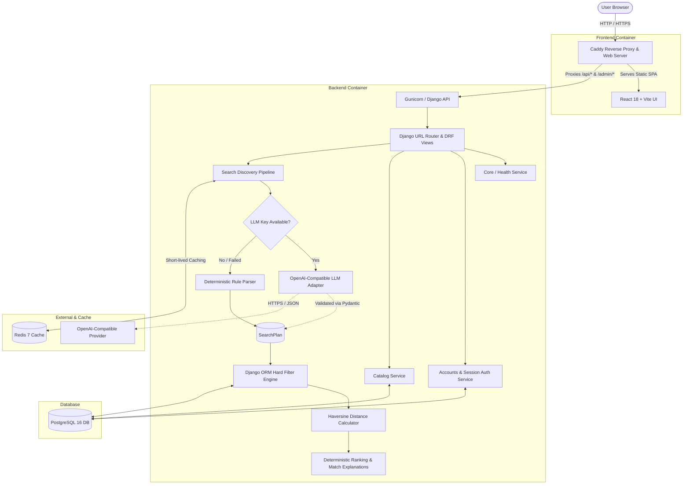

# FavvMenuz — AI Restaurant & Menu Discovery Platform

[](https://github.com/budhilnigam/FavvMenuz/actions/workflows/ci-cd.yml)

FavvMenuz is an AI-powered discovery platform that turns natural-language dining requests into structured database queries, deterministic filters, and grounded recommendations.

---

## 1. Project Introduction

Conventional food platforms force users to manually navigate multiple filter dropdowns and scan endless menus item by item. When someone asks:
- *"Find spicy vegetarian food under ₹350 near Sector 62"*
- *"Show me Jain-friendly dinner options within 3 km"*
- *"Crispy dosa under ₹200"*
- *"Find dishes without peanuts and exclude places without ingredient info"*

Standard keyword search fails because it cannot understand complex combinations of budget ceilings, dietary restrictions, spice intensity, and geography.

**FavvMenuz solves this problem by combining:**
1. **Natural-Language Interpretation**: An OpenAI-compatible LLM layer transforms conversational queries into a validated, typed `SearchPlan`.
2. **Deterministic Fallback Engine**: If no LLM API key is configured or an external provider fails, an internal regex-based rule engine deterministically extracts the exact same `SearchPlan`.
3. **Strict Database ORM Filtering**: The relational database enforces hard boundaries (budget limits, strict dietary certifications, allergen exclusions) — the AI is never allowed to hallucinate results or generate raw SQL.
4. **Transparent Relevance & Grounded Match Reasons**: Every returned dish displays verifiable reasons based on real database records (e.g. *"Certified Vegetarian"*, *"₹320 (Under your ₹350 budget)"*, *"Within 1.4 km of Sector 62"*).
5. **High-Contrast Neo-Brutalist Discovery Interface**: An editorial-meets-brutalist visual experience with tactile feedback, high contrast, and zero ambiguity.

> **Data Policy Notice:** FavvMenuz is a discovery and portfolio demo platform, **not a real-world ordering or delivery service**. All 50 restaurants, 640+ dishes, ratings, reviews, and localities around synthetic Noida are deterministically generated demo data.

---

## 2. Features

### Core Implemented Features
- **Natural-Language Discovery (`POST /api/search/`)**: Express cravings in natural language with automatic extraction of budget, cuisines, dietary requirements, spice preferences, distance, and localities.
- **Dual-Mode Search Engine**:
  - **AI Mode**: Integrates with OpenAI-compatible endpoints with strict timeout and validation guards.
  - **Deterministic Rule Fallback**: Complete standalone parsing for budget expressions, dietary tags, spice levels, distance expressions, and localities without external API dependencies.
  - **Visible Mode Indicator**: The UI explicitly shows whether a search used *AI Interpreted* or *Deterministic Fallback*.
- **Hard Constraint Enforcement**: If a user sets a maximum price of ₹350, dishes priced at ₹351 are never returned, regardless of relevance score.
- **Strict Dietary Filtering**: Explicit tags for `vegetarian`, `vegan`, `jain_friendly`, `gluten_free`, and `dairy_free`. Jain queries strictly exclude onion, garlic, and root vegetables.
- **Geographic Distance Calculations**: Computes great-circle distance using the Haversine formula in Python across synthetic Noida localities (`Sector 18`, `Sector 62`, `Sector 137`, `Sector 50`, `Sector 76`, `Sector 104`, `Noida Expressway`, `Greater Noida West`).
- **Grounded Match Reasons**: Explanations generated directly from matching record attributes, preventing AI hallucinations.
- **Session Authentication & CSRF**: Django built-in session authentication, secure password hashing, CSRF bootstrapping, and user registration/login/logout.
- **User Favorites**: Authenticated users can bookmark restaurants and menu items with strict cross-user data isolation.
- **Responsive Neo-Brutalist UI**: Built with React, TypeScript, Tailwind CSS, Lucide icons, and Framer Motion.
- **Caddy Reverse Proxy & Docker Deployment**: Single-host Docker Compose deployment with HTTPS support via Caddy.

### Future Enhancements (Post-MVP Roadmap)
- Text embeddings (`pgvector`) for hybrid semantic menu similarity.
- Interactive vector map view for geographic exploration.
- Personalized dish recommendations based on past favorites.
- PWA offline shell support.

---

## 3. Screenshots or Visual Preview

<!-- 
Add screenshots here after deploying to your AWS Lightsail or local host:


-->

| Landing & Natural Search | Structured Filters & Explanations |
| :---: | :---: |
| *Neo-Brutalist Hero with Natural-Language Input* | *Active Filter Chips, Grounded Match Reasons & Price Caps* |

---

## 4. Technology Stack

| Layer | Technology | Purpose |
| :--- | :--- | :--- |
| **Backend** | Python 3.12 / Django 5.1 / DRF | Core REST API, ORM, authentication, and validation |
| **Data Validation** | Pydantic v2 | Strict validation of structured LLM `SearchPlan` outputs |
| **HTTP Client** | `httpx` | Outbound requests to OpenAI-compatible LLM endpoint with timeouts |
| **Database** | PostgreSQL 16 (or SQLite in dev) | Primary relational store for restaurants, dishes, tags, and favorites |
| **Cache** | Redis 7 (`django-redis`) | Query plan caching and anonymous search result caching with graceful fallback |
| **Frontend** | React 18 / TypeScript / Vite | Single Page Application discovery interface |
| **Styling** | Tailwind CSS (Neo-Brutalist) | High-contrast visual language with thick borders and hard-offset shadows |
| **Icons & Motion** | `lucide-react` / `framer-motion` | Consistent icons and lightweight micro-interactions |
| **Web Server** | Caddy v2 | Static file serving, reverse proxying `/api`, automatic TLS |
| **Process Manager** | Gunicorn | Production WSGI application server |
| **Deployment** | Docker & Docker Compose on AWS Lightsail | Containerized, single-host deployment pipeline via GitHub Actions |

---

## 5. Architecture



---

## 6. Repository Structure

```text
FavvMenuz/
├── .github/workflows/ci-cd.yml      # Automated GitHub Actions test & Lightsail deploy
├── scripts/
│   ├── backup_db.sh                 # Database dump script
│   └── restore_db.sh                # Interactive safety-guarded restore script
├── backend/
│   ├── Dockerfile                   # Python 3.12 slim container with non-root appuser
│   ├── requirements.txt             # Pinned Django, DRF, Pydantic, HTTPX dependencies
│   ├── manage.py                    # Django management script
│   ├── config/                      # Django project settings, URLs, WSGI
│   └── apps/
│       ├── core/                    # Health checks (/healthz/) and status checks
│       ├── catalog/                 # Restaurant & MenuItem models, seed command, API views
│       ├── accounts/                # Session auth, CSRF bootstrap, User favorites
│       └── search/                  # Natural-language discovery pipeline, AI adapter, ranking
├── frontend/
│   ├── Dockerfile                   # Multi-stage Node build + Caddy static server
│   ├── Caddyfile                    # Caddy proxy rules and SPA routing
│   ├── package.json                 # React, Vite, Tailwind, Lucide dependencies
│   ├── vite.config.ts               # Vite configuration with local API proxy
│   └── src/
│       ├── api/                     # Native fetch API client with CSRF bootstrap
│       ├── hooks/                   # useAuth, useSearch, useFavorites
│       ├── components/              # SearchBar, FilterBar, Cards, Layout
│       ├── pages/                   # HomePage, SearchPage, RestaurantPage, FavoritesPage
│       └── styles/index.css         # Neo-brutalist styling utilities and variables
├── docker-compose.yml               # Local development stack (frontend, backend, db, redis)
├── docker-compose.prod.yml          # Production deployment stack for Lightsail
├── Makefile                         # Shortcuts: make up, make seed, make test, etc.
└── .env.example                     # Documented configuration template
```

---

## 7. Prerequisites

Before installing, ensure your environment has:
- **Docker Engine** (v24.0+) & **Docker Compose** (v2.20+)
- **Git**
- *(Optional for direct host development)*:
  - **Python 3.11+**
  - **Node.js 20+** & **npm 10+**
- *(Optional)*: An API key for any OpenAI-compatible completions endpoint (e.g. OpenAI, Groq, OpenRouter). **An API key is NOT required** — the app runs completely in deterministic fallback mode out of the box.

---

## 8. Local Setup

### Running with Docker Compose (Recommended)

1. **Clone the repository:**
   ```bash
   git clone https://github.com/budhilnigam/FavvMenuz.git
   cd FavvMenuz
   ```

2. **Configure environment:**
   ```bash
   cp .env.example .env
   ```

3. **Build and start all containers:**
   ```bash
   docker compose up --build -d
   ```

4. **Apply migrations and seed synthetic demo data:**
   ```bash
   docker compose exec backend python manage.py migrate
   docker compose exec backend python manage.py seed_demo_data
   ```

   The default seed is deterministic, offline, and repeatable: it uses fictional restaurant and cuisine menu templates, fixed Noida locality coordinates, and deterministic coordinate jitter. It does not call an AI model.

   For richer varied synthetic data, use the opt-in Bedrock generator:
   ```bash
   docker compose run --rm backend python manage.py seed_ai_demo_data --restaurants 24 --items-per-restaurant 12
   ```
   The command validates model JSON with Pydantic, assigns coordinates and ratings locally, and marks every record as demo data. Use `--reset` only when intentionally replacing the demo catalog.

5. **Open in browser:**
   - Web Application: [http://localhost](http://localhost)
   - Health Status: [http://localhost/healthz/](http://localhost/healthz/)

---

### Running Directly on Host (Without Docker)

1. **Backend setup:**
   ```bash
   python -m venv .venv
   # Windows:
   .venv\Scripts\activate
   # Linux/macOS:
   source .venv/bin/activate

   pip install -r backend/requirements.txt
   python backend/manage.py migrate
   python backend/manage.py seed_demo_data
   python backend/manage.py runserver 8000
   ```

2. **Frontend setup (in a new terminal):**
   ```bash
   cd frontend
   npm install
   npm run dev
   ```
   Open [http://localhost:5173](http://localhost:5173).

---

## 9. Configuration

All configuration is controlled through environment variables in `.env`.

| Variable | Description | Required? | Default / Example |
| :--- | :--- | :---: | :--- |
| `DJANGO_SECRET_KEY` | Django cryptographic signing key | Yes | Random 50+ character string |
| `DEBUG` | Django debug mode | Yes | `True` in dev, `False` in prod |
| `ALLOWED_HOSTS` | Comma-separated allowed hostnames | Yes | `localhost,127.0.0.1,backend` |
| `CSRF_TRUSTED_ORIGINS` | Trusted origins for CSRF POST requests | Yes | `http://localhost,http://127.0.0.1` |
| `SITE_ADDRESS` | Caddy server bind address or domain | Yes | `:80` or `https://yourdomain.com` |
| `POSTGRES_DB` | PostgreSQL database name | Yes | `favvmenuz_db` |
| `POSTGRES_USER` | PostgreSQL username | Yes | `favvmenuz_user` |
| `POSTGRES_PASSWORD` | PostgreSQL password | Yes | Strong secret |
| `POSTGRES_HOST` | Database hostname | Yes | `db` (Docker) or `localhost` |
| `POSTGRES_PORT` | Database port | Yes | `5432` |
| `REDIS_URL` | Redis connection URL | Optional | `redis://redis:6379/1` |
| `LLM_PROVIDER` | LLM service type (`bedrock` or `openai-compatible`) | Optional | `bedrock` |
| `LLM_BASE_URL` | OpenAI-compatible base URL (unused by Bedrock) | Optional | `https://api.openai.com/v1` |
| `LLM_API_KEY` | Secret API key for OpenAI-compatible providers | Optional | Empty for Bedrock |
| `LLM_MODEL` | Bedrock model identifier | Optional | `openai.gpt-oss-20b-1:0` |
| `AWS_REGION` | AWS region containing Bedrock model access | Optional | `us-east-1` |
| `LLM_TIMEOUT_SECONDS` | Outbound request timeout | Optional | `10.0` |
| `SESSION_COOKIE_SECURE` | Enforce HTTPS-only session cookies | Prod only | `True` (Prod) / `False` (Dev) |
| `CSRF_COOKIE_SECURE` | Enforce HTTPS-only CSRF cookies | Prod only | `True` (Prod) / `False` (Dev) |

### Generating a Secure Django Secret Key
Run:
```bash
python -c 'from django.core.management.utils import get_random_secret_key; print(get_random_secret_key())'
```

### Notice Regarding Third-Party LLM Usage
When `LLM_API_KEY` is provided, user queries are transmitted to the configured endpoint for natural-language interpretation. Third-party providers may incur separate usage fees. Never commit real keys to source control.

---

## 10. Using the Application

1. **Natural-Language Search**:
   Enter any query in the search bar (e.g. *"Show me spicy vegetarian dishes below ₹350 near Sector 62"*).
2. **Reviewing the Parsed Plan**:
   The search results screen displays active constraints extracted from your query (budget, locality, tags). Click any constraint chip or select *Refine Filters* to edit constraints on the fly.
3. **Checking Match Explanations**:
   Each dish card shows bulleted facts explaining why it matched (e.g. *"Under your ₹350 budget"*, *"Certified Vegetarian"*, *"Matches your 'Spicy' preference"*).
4. **Saving Favorites**:
   Click the bookmark icon on any dish or restaurant. If unauthenticated, you will be prompted to log in or create a quick demo account.

---

## 11. API Reference

All application endpoints are versioned under `/api/` (except `/healthz/`).

### 1. Health Status
- `GET /healthz/`
  - **Response (200 OK):**
    ```json
    {
      "status": "healthy",
      "checks": { "database": true, "cache": true },
      "duration_ms": 1.45,
      "service": "favvmenuz-api"
    }
    ```

### 2. Search & Discovery
- `POST /api/search/`
  - **Request Body:**
    ```json
    {
      "query": "Spicy vegetarian dishes under ₹350 near Sector 62",
      "max_price": 350.0,
      "sort_by": "relevance"
    }
    ```
  - **Response (200 OK):**
    ```json
    {
      "search_plan": {
        "query_text": "Spicy vegetarian dishes under ₹350 near Sector 62",
        "keywords": ["paneer"],
        "cuisines": ["North Indian"],
        "dietary_tags": ["vegetarian"],
        "min_price": null,
        "max_price": 350.0,
        "spice_level": "spicy",
        "locality": "Sector 62",
        "max_distance_km": null,
        "sort_by": "relevance"
      },
      "search_mode": "fallback",
      "total_results": 1,
      "results": [
        {
          "item": {
            "id": 14,
            "name": "Kadhai Paneer Spicy",
            "price_paise": 32000,
            "price_inr": 320.0,
            "category": "Main Course",
            "dietary_tags": ["vegetarian"],
            "spice_level": "spicy",
            "restaurant_name": "Spice Haven Sector 62",
            "restaurant_locality": "Sector 62"
          },
          "relevance_score": 92.5,
          "match_reasons": [
            "Dish matches 'paneer'",
            "Certified Vegetarian",
            "₹320 (Under your ₹350 budget)",
            "Matches your 'Spicy' spice preference"
          ],
          "distance_km": 0.4
        }
      ],
      "empty_suggestion": null,
      "is_demo_data": true
    }
    ```

### 3. Catalog Endpoints
- `GET /api/restaurants/`: Paginated restaurant list (`locality`, `cuisine`, `price_band`, `min_rating`).
- `GET /api/restaurants/<slug>/`: Detailed restaurant record with all menu items.
- `GET /api/menu-items/`: Paginated menu items with category and price filters.

### 4. Authentication Endpoints
- `GET /api/auth/csrf/`: Bootstrap CSRF cookie and token.
- `POST /api/auth/register/`: Register a new user (`username`, `password`, `password_confirm`).
- `POST /api/auth/login/`: Authenticate user session.
- `POST /api/auth/logout/`: Invalidate current session.
- `GET /api/auth/me/`: Retrieve authenticated user profile (401 if unauthenticated).

### 5. Favorites Endpoints
- `GET /api/favorites/`: List user's saved items.
- `POST /api/favorites/`: Add or toggle a favorite (`restaurant` or `menu_item`).
- `DELETE /api/favorites/<id>/`: Remove favorite by ID (enforces user ownership).

---

## 12. Testing and Quality Checks

### Running Backend Tests
Execute the full Django test suite:
```bash
# Using venv directly:
python backend/manage.py test apps

# Using Docker Compose:
docker compose exec backend python manage.py test apps
```

### Running Django System & Migration Checks
```bash
python backend/manage.py check
python backend/manage.py makemigrations --check --dry-run
```

### Running Frontend Checks
```bash
cd frontend

# TypeScript typechecking
npm run typecheck

# ESLint analysis
npm run lint

# Production bundle build
npm run build
```

---

## 13. Synthetic Data

To seed or reset the demo catalog:
```bash
# Non-destructive idempotent seed:
python backend/manage.py seed_demo_data

# Destructive clean reseed:
python backend/manage.py seed_demo_data --reset
```

- **Random Seed**: Uses fixed random seed `42` to ensure consistent generation across developer environments.
- **Geography**: Centered around realistic coordinates for Noida sectors (Sector 18, 62, 137, 50, 76, 104, Expressway, Greater Noida West).
- **Demo Tag**: All synthetic records have `is_demo=True`.

---

## 14. Security Notes

- **Session Security**: Session cookies use `HttpOnly=True` and `SameSite=Lax`. In production, `SESSION_COOKIE_SECURE=True` enforces HTTPS transmission.
- **CSRF Defense**: All state-changing requests (`POST`, `PUT`, `DELETE`) require a valid `X-CSRFToken` header.
- **Internal Network Isolation**: Database (port 5432) and Redis (port 6379) are strictly private to the Docker bridge network and never mapped to the public host.
- **Throttling**: The `/api/search/` endpoint is rate-limited (60 requests/minute) to guard against abuse and rate-limit exhaustion.
- **Single-Host Trade-Off**: Running web app, database, and cache on one host is suitable for portfolio and hobby deployments, but does not provide multi-region failover.

---

## 15. Limitations & Future Enhancements

- **Single-Host Capacity**: Designed for solo developer portfolio hosting on an AWS Lightsail instance (2GB - 4GB RAM).
- **Simulated Distance**: Coordinates are generated around synthetic Noida locality anchors rather than live GPS tracking.
- **Synchronous Execution**: Search queries run synchronously with 10-second timeouts; background workers (Celery) can be introduced if search traffic scales significantly.

---

## License
MIT License. Built by solo developer as a full-stack portfolio showcase.
